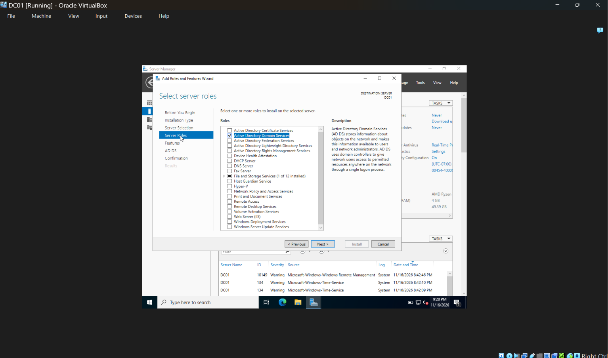
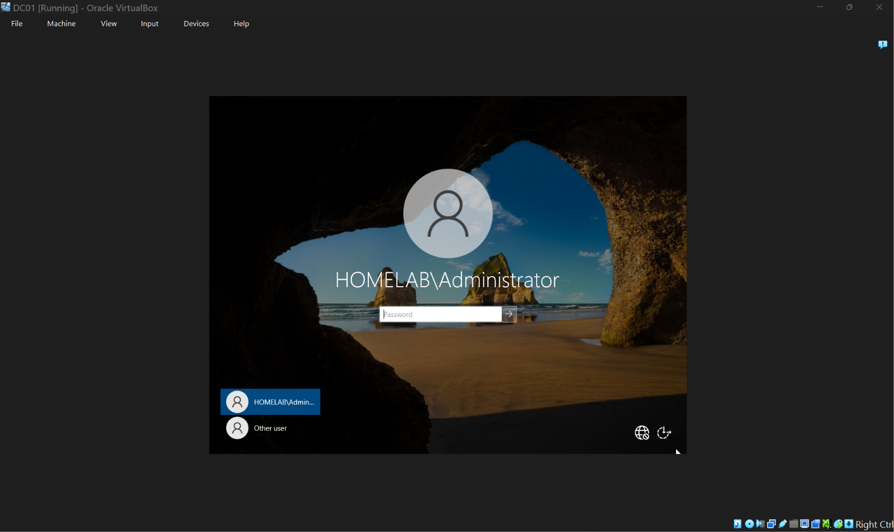
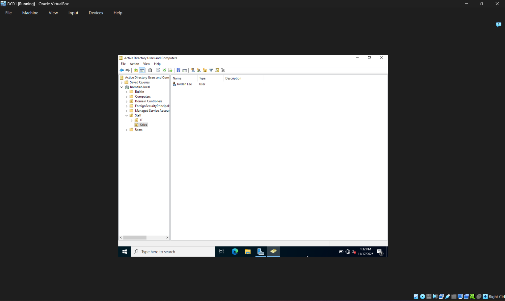
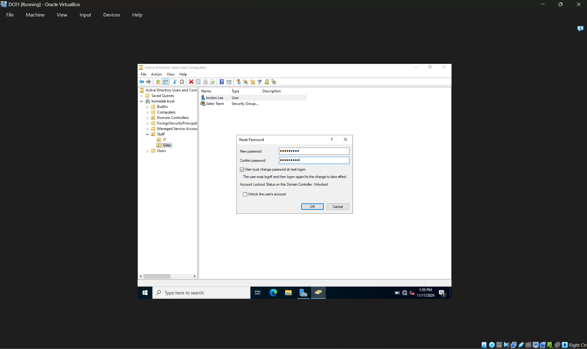
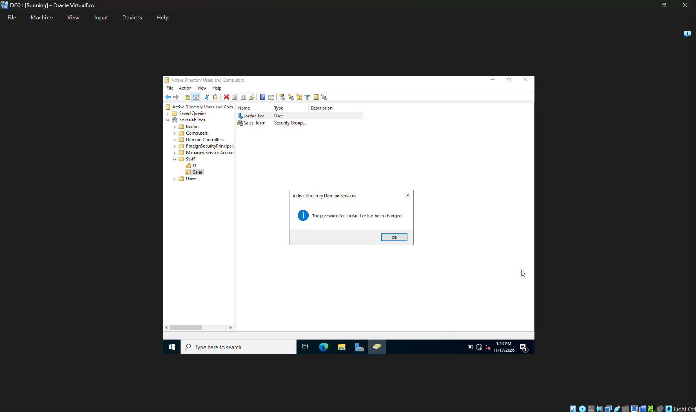
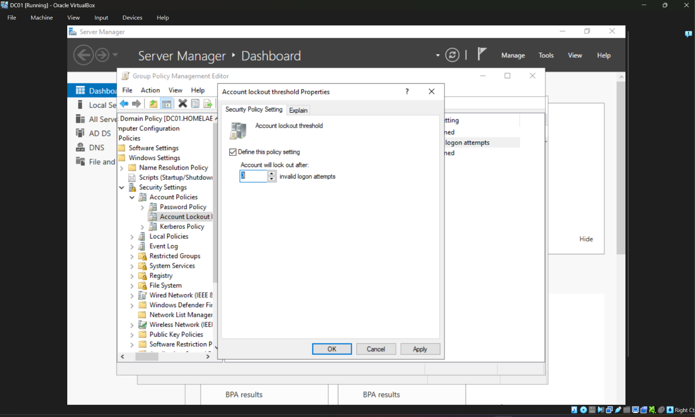
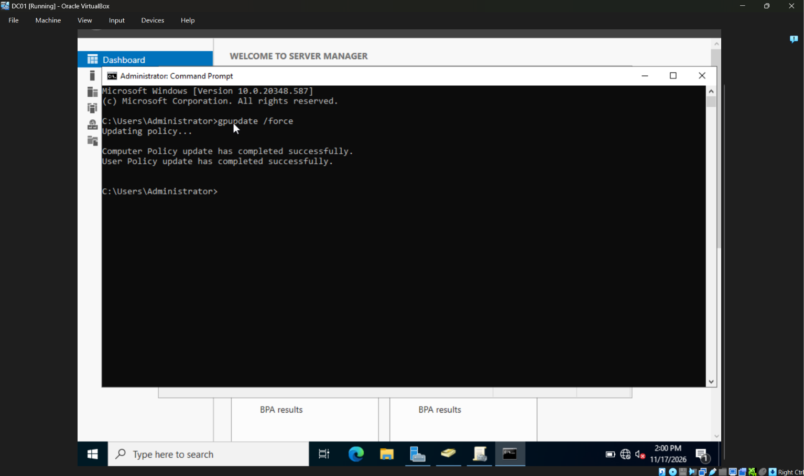
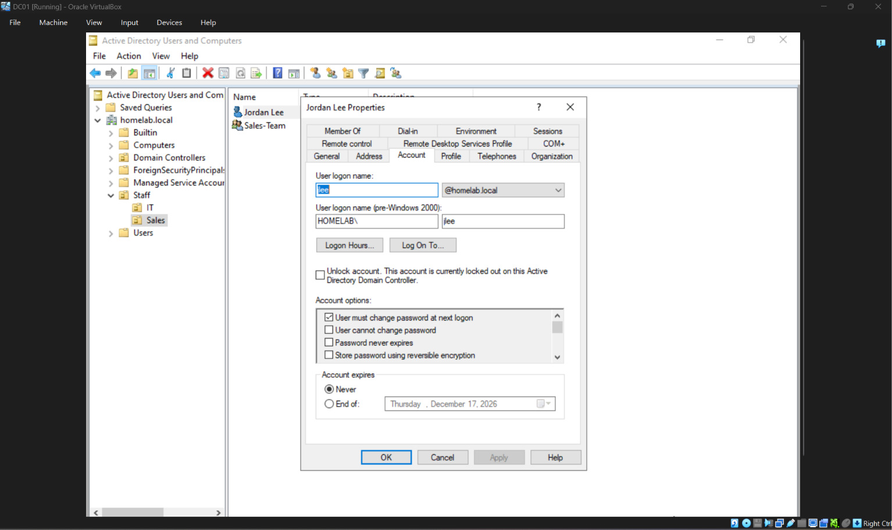
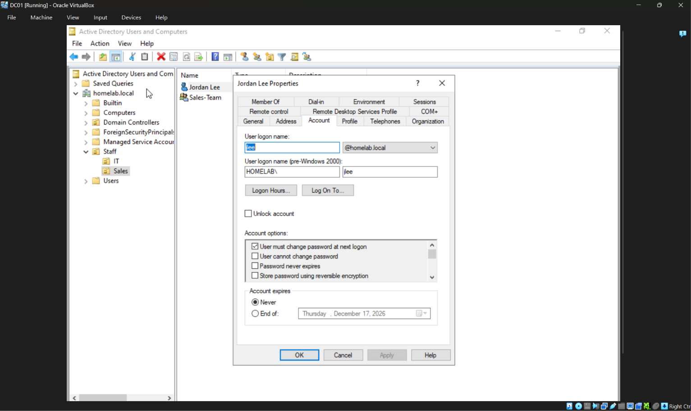

# Active Directory Home Lab

A Windows Server 2022 and Windows 11 lab I built in VirtualBox to practice the work a help desk technician handles every day: creating users, organizing them into OUs and groups, resetting passwords, disabling accounts, unlocking users who are locked out, and joining workstations to the domain.

## Lab Environment

| Component | Details |
|---|---|
| Hypervisor | Oracle VirtualBox |
| Server | DC01, Windows Server 2022 Standard Evaluation (Desktop Experience), 2 CPUs, 4 GB RAM, 50 GB disk |
| Client | CLIENT01, Windows 11 Enterprise Evaluation, 2 CPUs, 4 GB RAM, 64 GB disk, TPM 2.0, Secure Boot |
| Domain | homelab.local |
| Network | VirtualBox NAT Network "HomelabNet" (192.168.50.0/24) |
| DC01 address | 192.168.50.10 (static), also the domain's DNS server |
| Roles on DC01 | Active Directory Domain Services, DNS, Group Policy Management |

## What I Built

```
homelab.local
├── Computers
│   └── CLIENT01 (Windows 11, joined in Part 3)
└── Staff (OU)
    ├── IT (OU)
    │   └── Sam Rivera (disabled to simulate an offboarded employee)
    └── Sales (OU)
        ├── Jordan Lee (jlee)
        └── Sales-Team (security group)
```

## Part 1: Building the Server

### 1. Create the virtual machine
I created a new VM named DC01 and attached the Windows Server 2022 evaluation ISO.


### 2. Install Windows Server
I chose Standard Evaluation with Desktop Experience so I could manage the server through the graphical tools a help desk would normally use.


### 3. Rename the server
Windows assigns a random name during install. I renamed it to DC01 before installing Active Directory, since renaming a domain controller afterward is much more involved.


### 4. Install Active Directory Domain Services
Through Server Manager, I added the AD DS role, which also installed Group Policy Management and the AD administration tools.




### 5. Promote the server to a domain controller
I promoted DC01 to a domain controller and created a new forest called homelab.local. After the restart, the sign-in screen showed HOMELAB\Administrator, confirming the domain was live.




## Part 2: Help Desk Tasks

### 6. Organize users with OUs
I created a Staff OU with IT and Sales OUs inside it, then created a test user, Jordan Lee, in Sales. Organizing by department makes accounts easier to find and lets different policies apply to different teams.



### 7. Manage access with security groups
I created a Sales-Team security group and added Jordan to it. In a real environment, access to shared folders and apps is given to the group, so new hires get the right access just by being added.


### 8. Reset a password
I reset Jordan's password and checked "User must change password at next logon," so the temporary password only works once and the user picks their own.





### 9. Disable an account
I created Sam Rivera in the IT OU and disabled the account to simulate offboarding. Disabling instead of deleting keeps the account's group memberships and history in case they're needed later. The down arrow on the icon shows the account is disabled.


### 10. Set an account lockout policy
In Group Policy Management, I edited the Default Domain Policy to lock accounts after 3 invalid sign-in attempts, then ran `gpupdate /force` to apply it right away.





### 11. Lock out and unlock a user
To test the policy, I used `runas /user:homelab\jlee cmd` and entered the wrong password several times until Jordan's account locked. Then I unlocked it from the Account tab in Active Directory Users and Computers, the same way I would for a user calling in.





## Part 3: Joining a Windows 11 Client to the Domain

### 12. Put both VMs on a shared network
VirtualBox's default NAT setting gives each VM its own isolated network, so the client could never reach the server. I created a NAT Network called HomelabNet (192.168.50.0/24), which puts both VMs on the same network while still giving them internet access, and moved DC01 onto it.


### 13. Give the domain controller a static IP address
A domain controller should never change addresses, since every client depends on it for sign-in and DNS. I set DC01 to 192.168.50.10 with itself (127.0.0.1) as its DNS server, then ran `ipconfig /registerdns` and restarted the Netlogon service so the domain's DNS records pointed to the new address. Pings to the gateway and to google.com confirmed the network and DNS were working.


### 14. Build the Windows 11 client
I created CLIENT01 with TPM 2.0, Secure Boot, and EFI enabled, which Windows 11 requires, and attached it to HomelabNet. During setup I used "Domain join instead" to create a local account rather than a Microsoft account, the way a business would set up a workstation.


### 15. Point the client to the domain's DNS
A client finds its domain through DNS, so I set CLIENT01's DNS server to DC01 (192.168.50.10) while leaving its IP address on DHCP. Before joining, I confirmed three things: `ipconfig /all` showed the right DNS server, a ping reached DC01, and `nslookup homelab.local` resolved to DC01's address.


### 16. Rename the computer and join the domain
In System Properties, I renamed the computer from its random default name to CLIENT01 and joined it to homelab.local in the same step, using domain admin credentials.


After the restart, CLIENT01 appeared in the Computers container in Active Directory Users and Computers.


### 17. Sign in as a domain user
I signed in to CLIENT01 as Jordan Lee (HOMELAB\jlee), the test user from Part 2. Running `whoami`, `hostname`, and `echo %logonserver%` confirmed he was signed in with his domain account, on CLIENT01, and authenticated by DC01.


## Troubleshooting Along the Way

After promoting the server to a domain controller, the VM froze on a black screen during restart, and a reset didn't fix it. I worked through it step by step:

- Raised the VM's memory from 4 GB to 6 GB, since the first boot as a domain controller is resource heavy.
- Fixed the boot order so the hard disk came before the optical drive, and removed the installer ISO so the VM wouldn't try to boot from it.
- Gave the restart enough time. The first boot after promotion is slow, and it finished on its own once the VM had the resources it needed.

I also ran into a display issue where the VM was too small to read on a high-resolution screen. I fixed it at first with VirtualBox's display scaling, then installed VirtualBox Guest Additions on both VMs so the screen resizes with the window. On DC01, the Windows Server installer disc was still in the virtual drive, so I removed it before Guest Additions could load.

Part 3 brought a few more problems:

- Domain join rejected the password. The first join attempt failed with "The user name or password is incorrect." That error told me the client had actually reached the domain controller, so the network and DNS were fine and only the credentials were wrong. I reset the domain Administrator password on DC01 with `net user` and the join went through.
- Forgotten user password. I didn't remember Jordan's password from Part 2, so I reset it from Active Directory Users and Computers with "User must change password at next logon" checked, the same way I would for a user calling the help desk.
- Running two VMs on one laptop. With both VMs running, DC01 froze at times. Once the domain controller was set up, it no longer needed 6 GB, so I lowered it to 4 GB, gave the client 4 GB, and closed apps on the host to free up memory.

## Skills Practiced

- Installing and configuring Windows Server 2022
- Installing AD DS and promoting a domain controller
- Creating and organizing OUs, users, and security groups
- Password resets with forced change at next sign-in
- Disabling accounts for offboarding
- Configuring an account lockout policy with Group Policy
- Identifying and unlocking locked-out accounts
- Configuring a static IP address and DNS for a domain controller
- Building a Windows 11 workstation with TPM, Secure Boot, and EFI
- Pointing a client to internal DNS and verifying it with `ipconfig`, `ping`, and `nslookup`
- Joining a workstation to a domain and confirming it in Active Directory
- Verifying a domain sign-in with `whoami` and `%logonserver%`
- Troubleshooting VM resources, boot order, and domain join credential errors

## Next Steps

- Push a mapped network drive to the Sales team through Group Policy
- Repeat the account tasks in PowerShell (`New-ADUser`, `Set-ADAccountPassword`, `Unlock-ADAccount`, `Search-ADAccount -LockedOut`)
