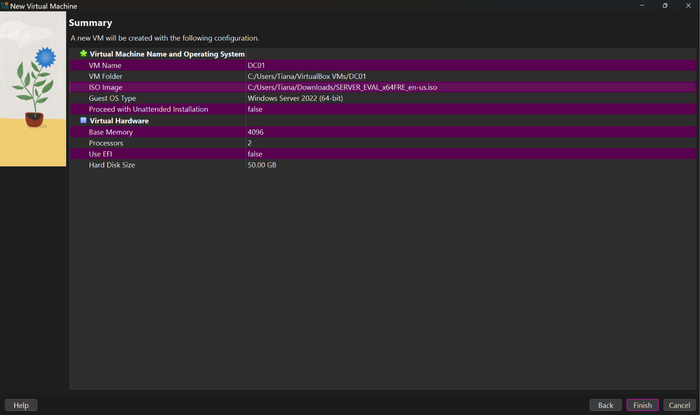
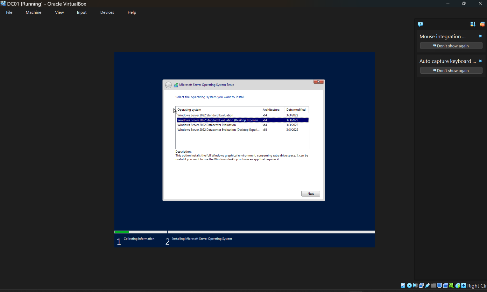
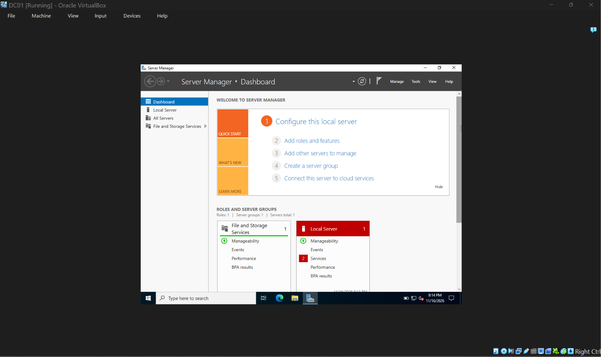
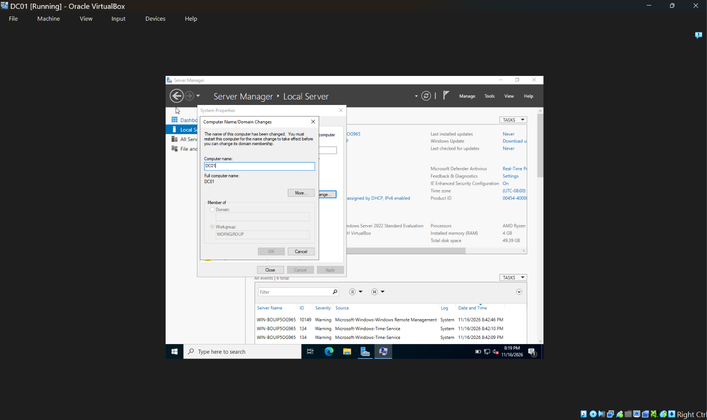
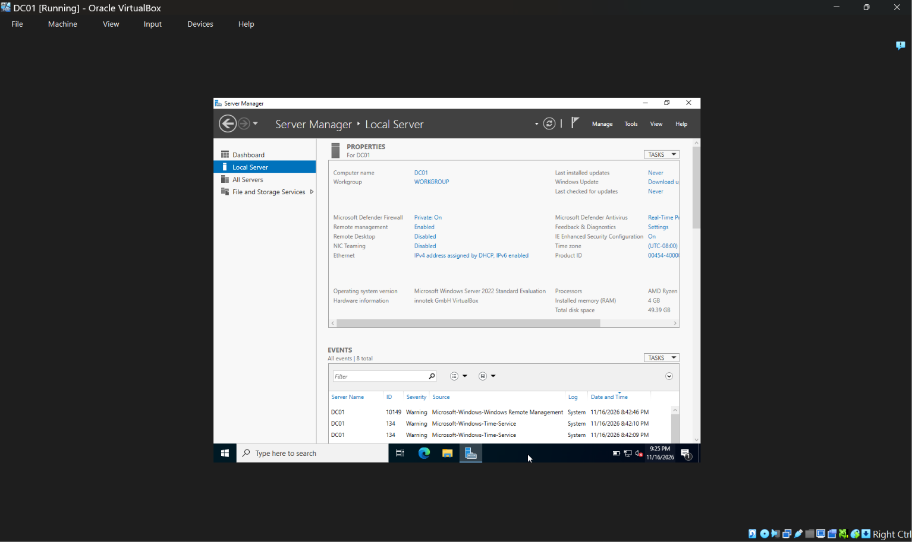
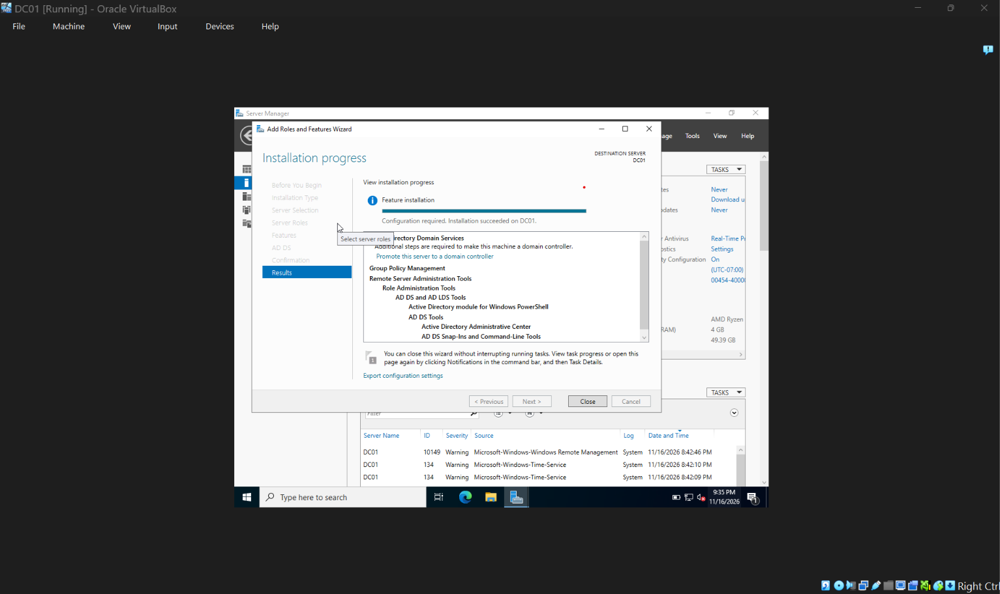
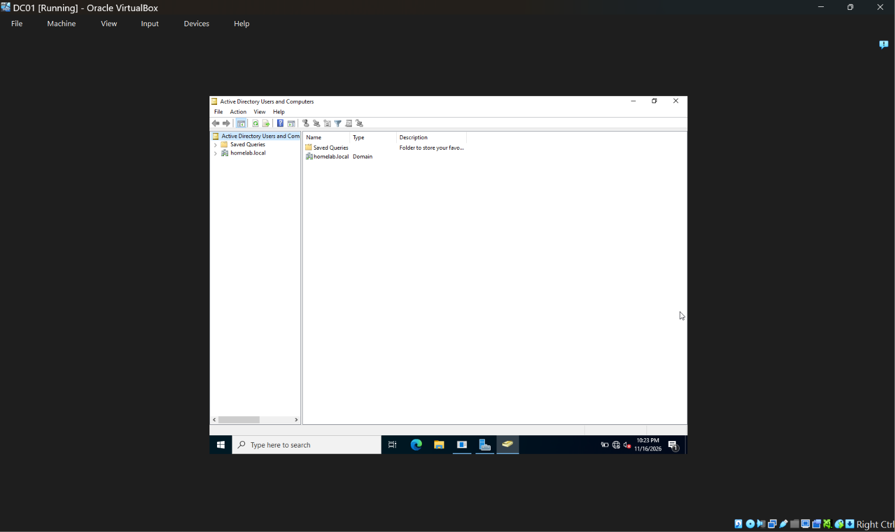
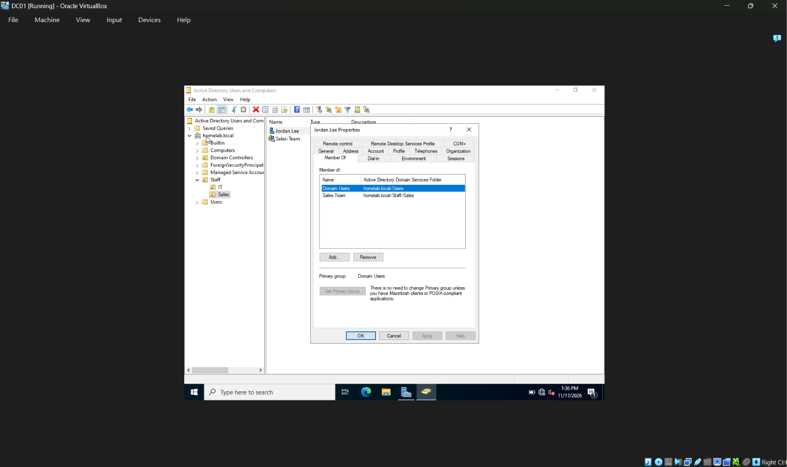
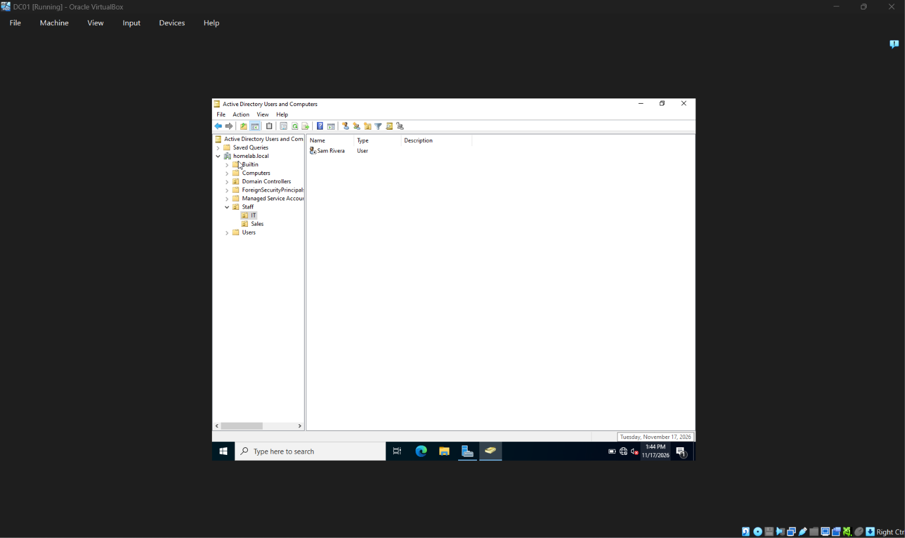

# Active Directory Home Lab

A Windows Server 2022 lab I built in VirtualBox to practice the account management tasks a help desk technician handles every day: creating users, organizing them into OUs and groups, resetting passwords, disabling accounts, and unlocking users who are locked out.

## Lab Environment

| Component | Details |
|---|---|
| Hypervisor | Oracle VirtualBox |
| Server OS | Windows Server 2022 Standard Evaluation (Desktop Experience) |
| Server name | DC01 |
| Domain | homelab.local |
| VM resources | 2 CPUs, 6 GB RAM (raised from 4 GB during troubleshooting), 50 GB disk |
| Roles | Active Directory Domain Services, DNS, Group Policy Management |

## What I Built

```
homelab.local
└── Staff (OU)
    ├── IT (OU)
    │   └── Sam Rivera (disabled to simulate an offboarded employee)
    └── Sales (OU)
        ├── Jordan Lee (jlee)
        └── Sales-Team (security group)
```

## Part 1: Building the Server

### 1. Create the virtual machine
I created a new VM named DC01 and attached the Windows Server 2022 evaluation ISO.



### 2. Install Windows Server
I chose Standard Evaluation with Desktop Experience so I could manage the server through the graphical tools a help desk would normally use.





### 3. Rename the server
Windows assigns a random name during install. I renamed it to DC01 before installing Active Directory, since renaming a domain controller afterward is much more involved.





### 4. Install Active Directory Domain Services
Through Server Manager, I added the AD DS role, which also installed Group Policy Management and the AD administration tools.




### 5. Promote the server to a domain controller
I promoted DC01 to a domain controller and created a new forest called homelab.local. After the restart, the sign-in screen showed HOMELAB\Administrator, confirming the domain was live.




## Part 2: Help Desk Tasks

### 6. Organize users with OUs
I created a Staff OU with IT and Sales OUs inside it, then created a test user, Jordan Lee, in Sales. Organizing by department makes accounts easier to find and lets different policies apply to different teams.


### 7. Manage access with security groups
I created a Sales-Team security group and added Jordan to it. In a real environment, access to shared folders and apps is given to the group, so new hires get the right access just by being added.



### 8. Reset a password
I reset Jordan's password and checked "User must change password at next logon," so the temporary password only works once and the user picks their own.


### 9. Disable an account
I created Sam Rivera in the IT OU and disabled the account to simulate offboarding. Disabling instead of deleting keeps the account's group memberships and history in case they're needed later. The down arrow on the icon shows the account is disabled.



### 10. Set an account lockout policy
In Group Policy Management, I edited the Default Domain Policy to lock accounts after 3 invalid sign-in attempts, then ran `gpupdate /force` to apply it right away.


### 11. Lock out and unlock a user
To test the policy, I used `runas /user:homelab\jlee cmd` and entered the wrong password several times until Jordan's account locked. Then I unlocked it from the Account tab in Active Directory Users and Computers, the same way I would for a user calling in.


## Troubleshooting Along the Way

After promoting the server to a domain controller, the VM froze on a black screen during restart, and a reset didn't fix it. I worked through it step by step:

- Raised the VM's memory from 4 GB to 6 GB, since the first boot as a domain controller is resource heavy.
- Fixed the boot order so the hard disk came before the optical drive, and removed the installer ISO so the VM wouldn't try to boot from it.
- Gave the restart enough time. The first boot after promotion is slow, and it finished on its own once the VM had the resources it needed.

I also ran into a display issue where the VM was too small to read on a high-resolution screen, which I fixed with VirtualBox's display scaling.

## Skills Practiced

- Installing and configuring Windows Server 2022
- Installing AD DS and promoting a domain controller
- Creating and organizing OUs, users, and security groups
- Password resets with forced change at next sign-in
- Disabling accounts for offboarding
- Configuring an account lockout policy with Group Policy
- Identifying and unlocking locked-out accounts
- Troubleshooting VM resource and boot order problems

## Next Steps

- Join a Windows 11 client to the domain and sign in as a domain user
- Push a mapped network drive to the Sales team through Group Policy
- Repeat the account tasks in PowerShell (`New-ADUser`, `Set-ADAccountPassword`, `Unlock-ADAccount`, `Search-ADAccount -LockedOut`)
